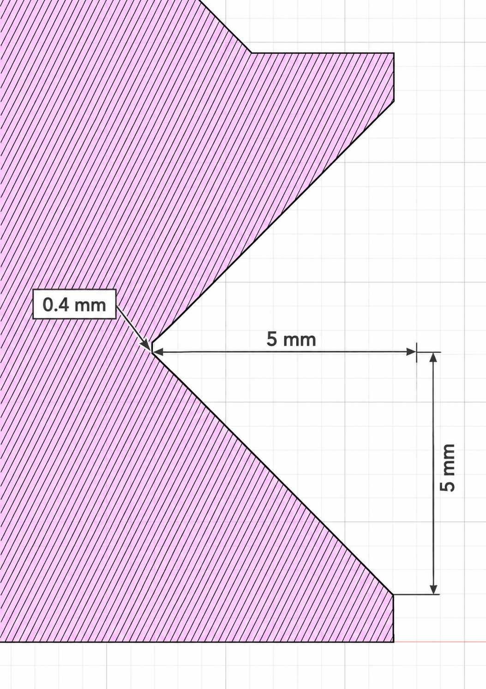
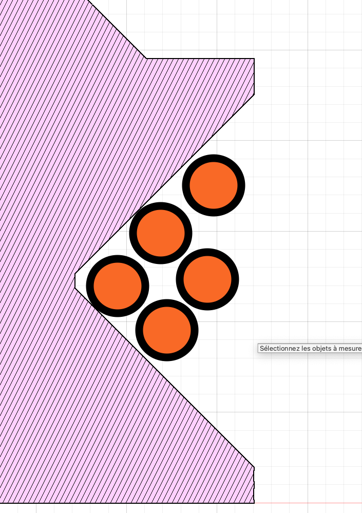

# Helmholtz coil lab notebook

Started 2026-10-13. This notebook records the coil construction and experiments
for HMC1001/HMC1002 sensitivity and minimum detectable AC field.

## Apparatus and open build details

| Item | Current record |
| --- | --- |
| Coil structure | Two Prusa Core One L printed forms; 290 mm nominal design diameter |
| Winding | Alpha Wire AZ181930, red, 18 AWG stranded tinned copper |
| Turn count and polarity | Five turns on each coil; additive wiring is intended |
| Coil separation | About 145.0 ± 0.5 mm; the separation of the winding centroids within the printed forms has not been measured |
| Permanent ballast | Nominal 100 Ω in series |
| Coil free leads | About 0.50 m each, or 1.0 m combined |
| Feed cable | 0.246 Ω total loop DC resistance |
| AC source | Agilent/Keysight 33500B |
| Magnetic readout | HMC1001/HMC1002, INA851 gain 51, AD7779 PGA up to 8 |

### 1) Wire

- Alpha Wire AZ181930, red, 100 ft; lot 156242-AW and DOM code 1218.
- Marked 1/C: 18 AWG (19/30) TC
- Conductor diameter 0.048 in (1.22 mm); nominal ETFE insulation wall
0.292 mm; finished diameter **(1.80 ± 0.05 mm)**.
0.96 mm² conductor area for this 19/30 construction. Nominal DC resistance:
**5.9 Ω/1000 ft at 20 °C = 0.01936 Ω/m**. Listed range -55 to 150 °C
and 600 V RMS.

### 2) Diameter printed and diameter added by wire stacking

The **290 mm printed diameter** is treated here as the nominal diameter at
the narrow bottom of the winding groove.

The next picture illustrates the **one–two–two stacking pattern**: one turn
deep in the V, two beside it, and two farther out. It is a placement sketch,
**not a dimensioned drawing of the wire**; the calculation uses the specified
**1.80 mm insulated diameter**.

#### Estimation of the real diameter
For an ideal tight stack of round, uncompressed wires touching their
neighbors and the approximately 45° groove walls, let $d=1.80$ mm be the
insulated wire diameter and $w=0.40$ mm the throat width. The first
conductor center is $x_0=d/\sqrt{2}-w/2=1.07$ mm radially beyond the groove
bottom. Each next layer adds $d/\sqrt{2}=1.27$ mm of radius.

| Position in stack | Turns per coil | Conductor-center radial offset from groove bottom | Conductor-center diameter if groove bottom is 290 mm |
| --- | ---: | ---: | ---: |
| Deepest | 1 | 1.07 mm | 292.15 mm |
| Middle | 2 | 2.35 mm | 294.69 mm |
| Outermost | 2 | 3.62 mm | 297.24 mm |

The arithmetic mean conductor-center diameter of the five turns is
**295.2 mm**. The stack varies near the start and end of the windings, so
use an estimated diameter of **295.2 ± 1.0 mm**, or radius of
**147.6 ± 0.5 mm**.

### 3) Resistance estimation

The two coils have five turns each at an estimated mean diameter of
295.2 mm. Two 145 mm crossings connect the coils, and the two 50 cm end
leads add another metre. The estimated total wire length is **10.56 ± 0.05 m**.
The stated uncertainty includes about 0.03 m from the winding diameter and
another 0.02 m allowance for lead lengths and twisted sections.

At the manufacturer's nominal 0.01936 Ω/m, the wire resistance is estimated
at **0.204 ± 0.001 Ω**, excluding contacts and joints.

## 5) Resistance survey

| Raw observation | Resistance |
| --- | ---: |
| Long feed cable, total loop | 0.246 +- 0.001 Ω |
| Coil measured through short leads, without 100 Ω ballast | 0.300 +- 0.005 Ω |
| Short measurement leads | 0.070 +-0.005 Ω |
| 100 Ω +-0.01% | 100.01 +-0.03 Ω |
| Complete coil, nominal 100 Ω ballast, and long feed cable | **100.35 +-0.01 Ω** |

Windings: 0.300 - 0.070 = **0.23+-0.01Ω**, this is 0.03 Ω above the estimation, this
is very acceptable considering some possible contact resistance.

**100.35 +-0.01 Ω** will be used for the current calculations.

### H1 — Predicted axial field of the assembled coil

For two identical thin circular coils, with $N$ turns each, mean radius
$R$, center separation $s$, and the same series current $I$, the midpoint
field is

$$
B(0)=\frac{\mu_0 N I R^2}{\left(R^2+(s/2)^2\right)^{3/2}}.
$$

For the assembled-coil model, use the estimated mean conductor-center
diameter $D=295.2\pm1.0$ mm, hence $R=147.6\pm0.5$ mm, and the reported
spacing $s=145.0\pm0.5$ mm. The spacing is slightly smaller than the mean
radius, so use the general expression above with these two different values.
With $N=5$ turns per coil, the predicted midpoint field is

$$
B(0)\approx(30.78\ \mathrm{\mu T/A})I.
$$

The stated diameter and spacing tolerances alone give a worst-case coil
constant of **30.68–30.89 µT/A**, approximately **30.78 ± 0.11 µT/A**
(±0.34%). If the two tolerances instead represent independent standard
uncertainties, their combined standard uncertainty is **±0.08 µT/A**
(0.25%). These ranges do not include the unmeasured radial and axial
positions of the individual turns or an offset between form spacing and
winding-centroid spacing. Once those positions are known, sum the field
contribution of each turn rather than relying on one mean radius.

### H2 — The 33500B can drive the planned AC ranges

The generator has a physical 50 Ω series output impedance. Its High Z
load setting changes displayed voltage, not that impedance. At low
frequency, using the reported 100.35 Ω assembly DC resistance and an
external current-reference resistor $R_{\rm ref}$,

$$
I_{\rm pk}\approx\frac{V_{\rm HighZ,pp}}
 {2(50\ \Omega+100.35\ \Omega+R_{\rm ref})}.
$$

This prediction omits coil reactance and generator amplitude error. Using
the estimated **30.78 µT/A** coefficient for the built geometry:

| Reference resistor | Intended peak field | Peak current | Approximate High Z setting |
| --- | ---: | ---: | ---: |
| 10 Ω | 1 µT | 32.5 mA | 10.42 Vpp |
| 10 kΩ | 1 nT | 32.5 µA | 0.660 Vpp |

The accessible reference resistor goes near the generator return in series
with the complete coil assembly. At each frequency measure its actual
resistance and AC voltage, then calculate
$I_{\rm pk}=V_{R,\rm pk}/R_{\rm ref}$. The hidden 100 Ω ballast limits
current but is not an accessible current measurement point. At the
33500B's 20 Vpp open-circuit maximum, the estimated built geometry reaches
about 1.92 µT peak with a 10 Ω reference. The installed ballast's power
rating and heating under insulation still need checking.

### H3 — Nominal sensor response predicts a measurable tone

The stated HMC sensitivity, 3.2 mV/V/gauss at 5.6 V bridge excitation,
predicts **17.92 mV/gauss = 179.2 µV/µT** at the bridge. INA851 gain 51
and AD7779 PGA gain 8 give nominal combined gain 408 and about **245,000
signed 24-bit codes/µT** using a 2.5 V reference. These are predictions,
not measured sensitivity. The balancing servo attenuates DC and slow
changes; other analog stages may change amplitude and phase versus
frequency. ADC counts per field measure the whole chain. Bridge-only
sensitivity needs independent electronic-gain or bridge-output measurement.

### H4 — Detectable field depends on frequency and observation time

Coil-off noise converted through the future measured response from
Entry 006 gives a field-equivalent amplitude spectral density. A detection
limit also
requires bandwidth or integration time and a detection criterion.
Ambient magnetic signals, generator leakage, cable pickup, and recording
disturbances may raise the practical limit. No calibrated detection
threshold has yet been measured with this coil.

## Planned tests — no results entered

### Entry 004 — Geometry and polarity

**Hypothesis:** measured conductor-center geometry and same-direction coil
currents support H1's field calculation.

1. Confirm five turns per coil and map the diagonal layering. Measure
   conductor-center diameters or each turn's radial and axial position,
   winding-centroid separation, and intended sensor-center position.
2. Sketch intercoil link, return, and feed routing. Check that each coil
   produces the same axial field direction for the same series current.
3. Record nearby magnetic materials and sensor-axis alignment.

**Results:** pending. **Next calculation:** replace H1 with the measured
winding geometry.

### Entry 005 — Current versus frequency

**Hypothesis:** generator setting predicts current approximately, but
measured reference-resistor voltage is required for calibration.

1. Insert a measured 10 Ω reference near generator return for microtesla
   tests and a measured 10 kΩ reference for nanotesla tests. Record probe
   loading and generator load setting.
2. Sweep planned frequencies and amplitudes. Record reference voltage
   amplitude and phase, current, source setting, and thermal drift.
3. Check for clipping and ballast heating at maximum planned drive.

**Results:** pending. **Next calculation:** replace H2's settings with
measured current-versus-setting data.

### Entry 006 — Sensitivity and frequency response

**Hypothesis:** response is approximately linear at proposed 0.5–1.5 µT
peak, while servo and filter response vary with frequency.

1. Record sensor identity and orientation, SET/RESET state, bridge voltage,
   INA851/PGA gains, ADC rate, and reference. Begin near 2 Hz; select
   further frequencies from the actual analog passband.
2. Fit sine amplitude and phase in measured current and ADC samples.
   Repeat amplitudes for linearity, clipping, and repeatability by axis.
3. Report complex ADC-counts-per-µT response and uncertainty. Characterize
   electronic gain independently before assigning bridge sensitivity.

**Results:** pending.

### Entry 007 — Noise floor and injection threshold

**Hypothesis:** field-equivalent noise and the smallest recoverable sine
depend on frequency and observation time; source-connected and
source-disconnected baselines may differ.

1. Record coil-off baselines with final wiring and ADC settings. Compare
   generator connected with output disabled against source disconnected.
   Record ambient and storage/radio activity; reject invalid ADC frames.
2. Convert measured output-noise spectrum through Entry 006's response.
   State bandwidth or integration time and signal-to-noise criterion.
3. Inject progressively smaller measured fields near the threshold with
   interleaved zero-field controls. Record detection success and uncertainty.

**Results:** pending.

## Template for the next entry

~~~text
### Entry 00X — Title
Bench date/time and location:
Status: planned / performed / analyzed
Question and hypothesis:
Apparatus, wiring, settings, and calibration references:
Procedure:
Raw observations and data-file IDs:
Calculations and uncertainty:
Result, interpretation, and limitations:
Next action:
~~~

## Sources

- [Alpha Wire AZ181930 product specification](https://www.alphawire.com/products/wire/hook-up-wire/premium/az181930)
- [Alpha Wire catalog, conductor area](https://www.alphawire.com/-/media/Project/AlphaWire/AlphaWire/2023-Master-Catalog/2023-MasterCat-English-20230609.pdf?rev=08a9584660404c8dad92412e1b961875)
- [NIST Helmholtz-coil geometry](https://nvlpubs.nist.gov/nistpubs/Legacy/SP/nbsspecialpublication300v3.pdf)
- [Honeywell HMC1001/HMC1002 data sheet](https://prod-edam.honeywell.com/content/dam/honeywell-edam/aero/en-us/products/navigation-and-sensors/sensors/low-field-high-precision-linear-1-and-2-axis-analog-magnetic-sensors/documents/hon-aero-1-and-2-axis-magnetic-sensors.pdf?download=false)
- [Keysight 33500 Series user guide](https://www.keysight.com/us/en/assets/9018-03290/user-manuals/9018-03290.pdf)
- [Keysight 33500B/33600A specifications](https://www.keysight.com/in/en/assets/7018-05928/data-sheets/5992-2572.pdf)
